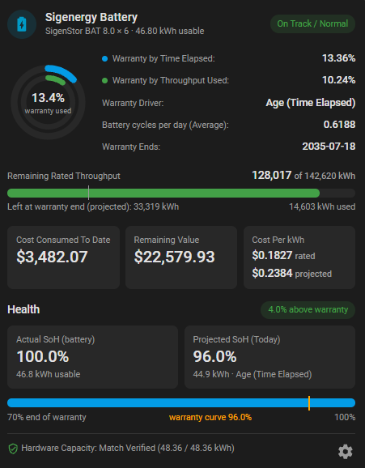

<p align="center"></p>

[![Marketplace][marketplace-badge]][marketplace-url]
[![release][release-badge]][release-url]
[![downloads][downloads-badge]][release-url]
[![stars][repo-stars-badge]][repo-url]
[![license][license-badge]][license-url]
[![installs][installs-badge]][installs-url]

[![maintained][maintained-badge]][commits-url]
[![activity][activity-badge]][commits-url]
[![Validate][validate-badge]][validate-url]
[![Tests][tests-badge]][tests-url]

___

Home Assistant custom integration to track Energy Storage System (ESS) battery health, throughput warranty,
degradation, cost per kWh, and remaining asset value.

Battery specifications come from the community [BatteryLedger Store](https://roving-ronin.github.io/BatteryLedger-Store/)
([repo](https://github.com/Roving-Ronin/BatteryLedger-Store)), so you pick your battery instead of typing in
warranty figures.

## Installation Methods:

BatteryLedger isn't in the default list yet, so add it as a custom repository first.

### Marketplace (Home Assistant 2026.11 and newer)

[![Open this repository in the Marketplace][marketplace-button]][marketplace-url]

If that button doesn't open BatteryLedger, the HACS button below also works on Home Assistant 2026.11 and newer,
or add it manually:

1. Go to **Settings → Marketplace**, open the ⋮ menu and choose **Custom repositories**
2. Add `https://github.com/Roving-Ronin/BatteryLedger` as an **Integration**
3. Search for **BatteryLedger** and click **Download**
4. Restart Home Assistant, then go to **Settings → Devices & services → Add integration → BatteryLedger**

### HACS (Home Assistant 2026.10 and older)

[![Open this repository in HACS][hacs-button]][hacs-url]

Or add it manually:

1. Open **HACS**, open the ⋮ menu and choose **Custom repositories**
2. Add `https://github.com/Roving-Ronin/BatteryLedger` as an **Integration**
3. Search for **BatteryLedger** and click **Download**
4. Restart Home Assistant, then go to **Settings → Devices & services → Add integration → BatteryLedger**

## Setup

1. **Find your battery:** choose **Detect from my battery's integration**, search the Store, or enter the details
   from your datasheet manually.
   - **Detect** looks through the integrations BatteryLedger knows (step 3) and reads what they report about the
     batteries to suggest the model and number of modules, which you confirm on the next step:
     - **Sigenergy (Sigenergy Local Modbus):** each inverter's battery pack count and rated battery capacity give
       the capacity per module (48.36 kWh ÷ 6 = 8.06 kWh: BAT 8.0), and its model type tells SigenStor from Neo.
     - **sigenergy2mqtt (Sigen Cloud):** each module's rated capacity.
     - **Huawei / iStore (wlcrs):** rated capacity ÷ battery packs with a serial number: 5.0 kWh is the S0, 6.9 kWh
       the S1. The S1 is shown as detected (the Huawei and iStore warranties are the same); for the S0 you choose
       Huawei or iStore, as their warranties differ.
     - **BYD Battery Box:** towers × modules and capacity per module (HVS or HVM).
     - **AlphaESS (senalse):** battery module count.
     - **Energy Manager and other integrations:** rated capacity alone, as a whole number of modules of one model
       (Energy Manager's inverter brand narrows the brand). When more than one model fits, you choose.

     Some of these sensors are off by default in their integration. Detect lists them and, if you agree, turns them
     on, checks for their readings after 45 seconds (and again 45 seconds later if needed), then carries on; it
     never turns on a sensor you turned off. Sensors it turns on stay on, even if you remove BatteryLedger later;
     turn them off under Settings → Entities if you no longer want them.
   - **Store search:** by text, brand, region and phase (single / three), then pick the model (e.g. Sigenergy
     SigenStor vs Neo, Sungrow SBR vs SBH) from those matching. **Tick every model installed**, e.g. both BAT 8.0
     and BAT 10.0 if you have a mix.

   The Store list is downloaded once a day (no account needed) and a copy ships with each release for offline use.
2. **Battery groups:** for each model, the number of modules/units, the warranty start date and what they cost
   (optional, in your Home Assistant currency). Use *Add another model or later install* for modules of the same
   model added later with a different warranty start date: they keep their own cost and warranty clock.
3. **Inverter integration:** BatteryLedger looks for your inverter integration's sensors using the Store's
   *sensor profiles* (matched by entity registry unique ID, so renamed entities still work) and lists the
   integrations it knows for your battery brand:
   - **Sigenergy:** [TypQxQ's Sigenergy Local Modbus](https://github.com/TypQxQ/Sigenergy-Local-Modbus),
     [sigenergy2mqtt](https://github.com/seud0nym/sigenergy2mqtt)
   - **AlphaESS:** [senalse's AlphaESS Modbus TCP](https://github.com/senalse/ha-alphaess-modbus)
   - **BYD:** [redpomodoro's BYD Battery Box](https://github.com/redpomodoro/byd_battery_box) (reads the battery's
     BMS, including state of health), or [redpomodoro's Fronius Modbus](https://github.com/redpomodoro/fronius_modbus)
     with a Fronius GEN24
   - **Deye:** [davidrapan's Solarman](https://github.com/davidrapan/ha-solarman),
     [Lewa-Reka's ESPHome Deye Inverter](https://github.com/Lewa-Reka/esphome-deye-inverter)
   - **Fronius (GEN24 with Reserva or BYD):** [redpomodoro's Fronius Modbus](https://github.com/redpomodoro/fronius_modbus).
     The core Fronius integration has no battery energy totals.
   - **GoodWe (ET, EH, BT and BH hybrids):** [GoodWe](https://www.home-assistant.io/integrations/goodwe/) (core, or
     [mletenay's custom version](https://github.com/mletenay/home-assistant-goodwe-inverter)). GoodWe's ES-family
     inverters don't report lifetime battery energy, so use Energy Manager or choose the sensors yourself.
   - **Huawei and iStore:** [wlcrs's Huawei Solar](https://github.com/wlcrs/huawei_solar). With an EMMA (or
     SmartLogger), its site-wide totals cover a cascaded stack of up to 3 inverters.
   - **Sungrow:** [mkaiser's Sungrow SHx Modbus package](https://github.com/mkaiser/Sungrow-SHx-Inverter-Modbus-Home-Assistant),
     [Wingman3434's Sungrow SHx Inverter](https://github.com/Wingman3434/sungrow-shx-inverter-hacs)
   - **All of these brands:** [Energy Manager](https://github.com/ha-energymanager/ha-energymanager). If it's
     installed, its battery install date and cost pre-fill the first battery group, and the install date and cost
     of batteries added later (`battery_install_date_2`, `battery_install_cost_2`) the second.

   You can also choose the sensors yourself.
4. **Battery modules** (when available, e.g. sigenergy2mqtt with the Sigen Cloud API enabled): per-module
   discharge counters are assigned to your battery groups by each module's rated capacity, and each module is
   tracked against its own warranty limit.
5. **System:** whether cost per
   kWh and cost sensors show the currency symbol (`$`, `$/kWh`, the default, as in the YAML package) or code
   (`AUD`, `AUD/kWh`, which Home Assistant formats as money in each user's locale), and the sensors (filled in from step 3 if detected): lifetime
   **charged** and/or **discharged** energy, and optionally rated capacity (hardware check) and battery state of
   health.

The sensors, the currency display and each battery group's cost can be changed later under **Configure**.
Costs use your Home Assistant currency (Settings → System → General).

**Dates:** the warranty start date picker and the card show dates in the format set in each user's Home Assistant profile
(your name at the bottom of the sidebar → Profile → **Date format**). It defaults to your profile language's
format, so English shows month-day-year; choose **Day-Month-Year** there for day first (e.g. 18/7/2035).

## Dashboard card

<p align="center"></p>

BatteryLedger installs its own dashboard card; there's nothing extra to download or add as a resource. Edit a
dashboard, add a card and pick **BatteryLedger**, then choose the setup if you have more than one. In YAML:

```yaml
type: custom:battery-ledger-card
entry_id: <optional; the first setup is used if left out>
```

The card has four sections:
- **Warranty:** two rings show how much of the warranty is used by age (time elapsed) and by usage (throughput).
  The larger one is the warranty driver, shown first with cycles per day. Below are two warranty end dates, each
  above its share: by age, labelled with your battery's warranty period (e.g. **Warranty Ends (10 years)**:
  warranty start + 10 years), and **Warranty Ends (by usage)**, when the throughput limit would be reached at your
  average daily use so far. The warranty ends at whichever comes first, shown in red.
- **Throughput:** remaining warrantied usage (rated throughput) counts down, with a marker for what's projected
  to be left when the warranty ends.
- **Cost:** value used to date (the `cost_consumed_to_date` sensor), remaining value, and cost per kWh, rated and
  projected.
- **Health:** your battery's reported state of health against the warranty curve (Estimated Usable
  Capacity, what the warranty allows at this age and usage), on a scale from the end-of-warranty capacity
  to 100%. The hardware capacity check and module figures are shown when available.

Tap any figure to open its sensor. The bottom right corner shows the BatteryLedger version; admins also see a cog just to its left. It opens the card
settings: decimal places for cost per kWh (2 to 5), how dates are shown (your Home Assistant date format, or
day month year such as 18 Jul 2035), and which sections to show. The settings are saved for each
BatteryLedger setup, so the card looks the same on every dashboard and device.

## Sensors

Entity IDs are `sensor.battery_ledger_<name>`. A second BatteryLedger setup gets `_2` on the end, and so on.

At startup the sensors stay unavailable until every source sensor you chose has reported, so a battery
integration that's still connecting (Modbus, MQTT, cloud) isn't mistaken for a sensor that isn't set up. If one
hasn't reported 5 minutes after Home Assistant starts, BatteryLedger calculates without it (with the usual note).
If a source drops out later, its last reading is used until it's back.

| Entity ID (`sensor.battery_ledger_…`) | What it shows | Attributes |
|---|---|---|
| `total_rated_throughput` | Total warranted energy throughput for the configured units | `total_pack_count` |
| `remaining_rated_throughput` | Warranted throughput still left | |
| `rated_throughput_used` | Energy counted against the warranty so far | `groups`, `notes` |
| `cycles_per_day` | Full equivalent cycles per day: energy counted ÷ days since warranty start ÷ rated capacity (the inverter's rated capacity sensor, else the spec's figure × units). Replaces the YAML package's `battery_cycles_per_day` | |
| `warranty_time_elapsed` | Time since warranty start as % of the warranty period | |
| `projected_warranted_throughput` | Throughput by the end of the warranty at the average rate so far (capped at the limit) | `average_daily_kwh`, `low_confidence` |
| `cost_per_kwh_rated` | Battery cost ÷ warranted throughput (battery groups with a cost) | |
| `cost_per_kwh_projected` | Battery cost ÷ projected throughput (battery groups with a cost) | |
| `cost_consumed_to_date` | Cost apportioned to warranty life used: each battery group's cost by its own warranty driver (time elapsed or throughput used, whichever is further along), added up. `percent_of_rated_life_used` stays the throughput share. Each group's `cost` and `cost_consumed` are in the `groups` attribute | `percent_of_rated_life_used`, `estimated_remaining_value` |
| `initial_usable_capacity` | Usable capacity at beginning of life | |
| `estimated_usable_capacity` | Warranty floor health %: the minimum capacity the warranty guarantees today (see below) | `remaining_usable_kwh`, `degradation_driver`, `warranty_status`, `groups`, `notes` |
| `hardware_capacity_validation` | Whether the inverter's reported capacity matches the configured units (if a rated capacity sensor is set) | `configured_rated_kwh`, `reported_hardware_kwh` |
| `soh_above_warranty_floor` | Reported state of health minus the warranty floor, in percentage points (if a SoH sensor is set) | `reported_soh_pct`, `warranty_floor_pct` |
| `most_used_module_throughput` | Highest per-module share of its warranted throughput (module tracking) | `worst_module`, `modules`, `module_total_vs_plant_pct` |
| `module_soc_spread` | Highest minus lowest module state of charge right now (module tracking) | `module_soc` |

Coming from the original YAML package: its nine sensors are reproduced exactly (states, units, icons, attribute
names and values, friendly names), with `sigen_battery_` replaced by `battery_ledger_`. Remove the YAML package
before setting up BatteryLedger in the same Home Assistant. BatteryLedger adds only sensors with new information: `rated_throughput_used`, `warranty_time_elapsed`,
`cycles_per_day`, and the module and SoH sensors. *Projected Warranted Throughput* is the package's
formula (cycles per day × capacity × warranty days, i.e. average daily throughput × warranty days) with the
days taken from the warranty start date, so no separate age or cycles sensors are needed; it's capped at the
warranted total. `cycles_per_day` replaces the package's `battery_cycles_per_day`. Friendly names start with "Battery" for every brand.

## What the numbers mean (and don't)

- **Warranty floor, not state of health.** Warranties promise e.g. 70% capacity after 10 years *or* a throughput
  limit, whichever comes first. BatteryLedger takes whichever is further along and interpolates from 100% down to
  that end-of-life figure. That is the capacity the manufacturer guarantees at this point, not a measurement of
  your battery's actual health.
- **Charged vs discharged.** Some warranties count throughput as charged energy, some as discharged, and many don't
  say. When the warranty doesn't say, or the matching sensor isn't configured, BatteryLedger uses charged energy,
  which is always the larger figure, so it errs towards the warranty running out sooner. The sensor attributes say
  which counter was used.
- **Multiple battery groups** sharing one plant-level energy counter can't be separated exactly. Energy is split by
  usable capacity × days in service, which assumes broadly even use.
- **Per-module tracking** measures each module against its own limit (Sigen's throughput warranty is per
  module), so one heavily used module shows up even when the system average looks fine. It needs a counter for
  every configured module and a per-unit warranty counted on discharged energy; otherwise the plant counter is
  used. Cloud data is unofficial and can lag; the `module_total_vs_plant_pct` attribute compares the module
  total with the plant counter.
- **SoC spread** is a snapshot. A gap that persists in the history graph can point to imbalance, but a single
  reading means little, and BatteryLedger doesn't label a module weak from it.
- **Reported SoH** is the battery management system's own estimate; BatteryLedger shows it against the warranty
  floor but can't verify it.
- **Projections** are unreliable in the first month (`low_confidence` attribute).
- **Spec updates:** your chosen spec is copied into your setup. If the Store later revises it, a Repairs notice
  shows what changed and lets you accept it, so figures never change silently.

## Requirements

Home Assistant 2025.1 or newer. BatteryLedger's own icon and logo show from 2026.3 onwards; older versions show a placeholder.

## Sensor attribute notes

The `notes` attribute on the *Throughput used* and *Warranty floor health* sensors lists codes for anything
estimated or substituted:

| Code | Meaning |
|---|---|
| `plant_energy_split_by_capacity_and_age` | Several battery groups share one plant energy counter, so it was split between them by usable capacity × days in service (an estimate) |
| `basis_unstated_using_charged` | The warranty doesn't say whether throughput counts charged or discharged energy, so charged energy (the larger figure) was used |
| `basis_unstated_using_discharged` | As above, but only a discharged energy sensor is configured |
| `discharged_sensor_missing_using_charged` | The warranty counts discharged energy, but no discharged sensor is configured |
| `charged_sensor_missing_using_discharged` | The warranty counts charged energy, but no charged sensor is configured |
| `module_counters_not_used:<spec id>:<found>/<configured>` | Module sensors exist for that battery group but couldn't be used (not every module found, or the warranty isn't per unit on discharged energy) |

`degradation_driver` (on *Warranty floor health*) is `Age (Time Elapsed)` or `Throughput (Cycles)`: whichever of
time and throughput is further through the warranty. Before 0.1.9 the second was `Throughput (Cycle Abuse)`.

## Reporting problems

Use the [issue templates](https://github.com/Roving-Ronin/BatteryLedger/issues/new/choose). Bug reports missing
the BatteryLedger version, Home Assistant version or battery are labelled `question` and closed after 5 days if
they're not updated. Comment `/reopen` on your own closed issue to reopen it.

## Development

```bash
pip install -r requirements_test.txt
pytest -q
```

`tests/test_ledger.py` covers the calculations without Home Assistant; `tests/test_integration.py` runs the setup
flow, sensors and Store-revision repairs in a test Home Assistant instance.

The bundled Store snapshot is `custom_components/battery_ledger/data/index_snapshot.json`; refresh it from the
Store's published `index.json` before each release.

## Releasing

Draft a new GitHub release, create a tag such as `v0.2.0` on `main`, and publish. The release workflow takes the
version from the tag, writes it into `manifest.json`, attaches `battery_ledger.zip` to the release (what the Marketplace / HACS installs
and the download badge counts), and commits the version back to `main`. Mark betas as a pre-release (e.g. `v0.3.0b1`);
they don't change the version on `main`.


<!-- Badges -->

[marketplace-badge]: https://img.shields.io/badge/Marketplace%20-%20Custom-orange?style=flat-square
[release-badge]: https://img.shields.io/github/v/release/Roving-Ronin/BatteryLedger?style=flat-square&color=blue&label=Release
[downloads-badge]: https://img.shields.io/github/downloads/Roving-Ronin/BatteryLedger/total?style=flat-square&label=Downloads
[installs-badge]: https://img.shields.io/badge/dynamic/json?color=41BDF5&logo=home-assistant&label=integration%20usage&suffix=%20installs&cacheSeconds=15600&url=https://analytics.home-assistant.io/custom_integrations.json&query=$.battery_ledger.total&style=flat-square
[maintained-badge]: https://img.shields.io/badge/Maintained-yes-brightgreen?style=flat-square
[activity-badge]: https://img.shields.io/github/commit-activity/y/Roving-Ronin/BatteryLedger?style=flat-square&label=Commit%20Activity
[license-badge]: https://img.shields.io/github/license/Roving-Ronin/BatteryLedger?style=flat-square&label=License
[repo-stars-badge]: https://img.shields.io/github/stars/Roving-Ronin/BatteryLedger?style=flat-square&logo=github&label=Repo%20Stars
[validate-badge]: https://img.shields.io/github/actions/workflow/status/Roving-Ronin/BatteryLedger/validate.yaml?branch=main&label=Validate&style=flat-square
[tests-badge]: https://img.shields.io/github/actions/workflow/status/Roving-Ronin/BatteryLedger/tests.yaml?branch=main&label=Tests&style=flat-square

<!-- Install buttons -->

[marketplace-button]: https://my.home-assistant.io/badges/marketplace_repository.svg
[marketplace-url]: https://my.home-assistant.io/redirect/marketplace_repository/?owner=Roving-Ronin&repository=BatteryLedger&category=integration
[hacs-button]: https://my.home-assistant.io/badges/hacs_repository.svg
[hacs-url]: https://my.home-assistant.io/redirect/hacs_repository/?owner=Roving-Ronin&repository=BatteryLedger&category=integration

<!-- References -->

[repo-url]: https://github.com/Roving-Ronin/BatteryLedger
[release-url]: https://github.com/Roving-Ronin/BatteryLedger/releases
[installs-url]: https://analytics.home-assistant.io/custom_integrations.json
[commits-url]: https://github.com/Roving-Ronin/BatteryLedger/commits/main
[validate-url]: https://github.com/Roving-Ronin/BatteryLedger/actions/workflows/validate.yaml
[tests-url]: https://github.com/Roving-Ronin/BatteryLedger/actions/workflows/tests.yaml
[license-url]: https://github.com/Roving-Ronin/BatteryLedger/blob/main/LICENSE
